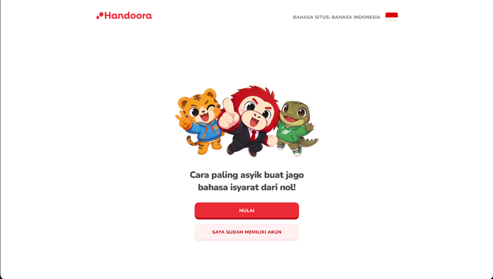
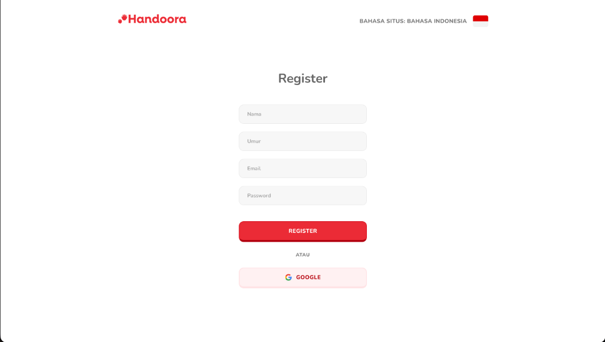
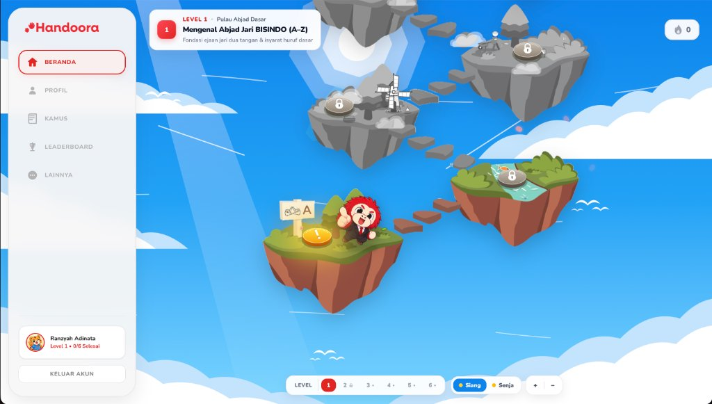
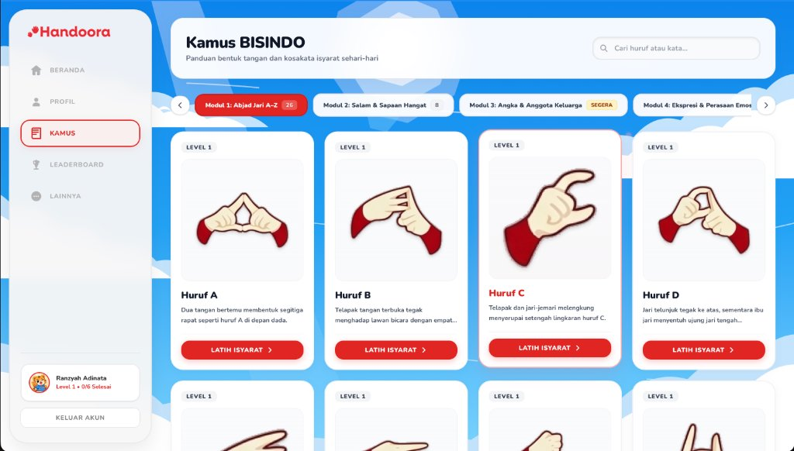
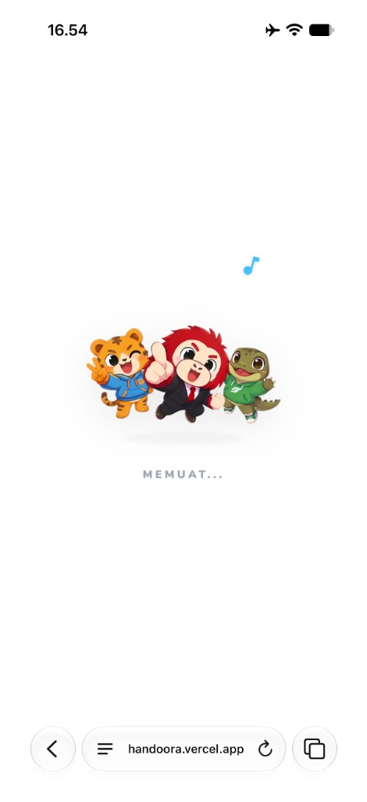
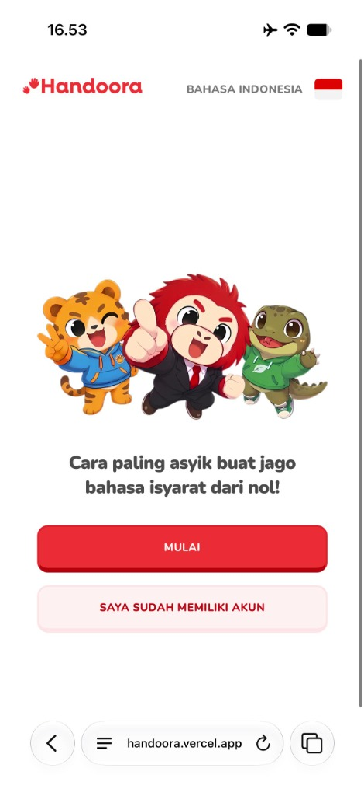
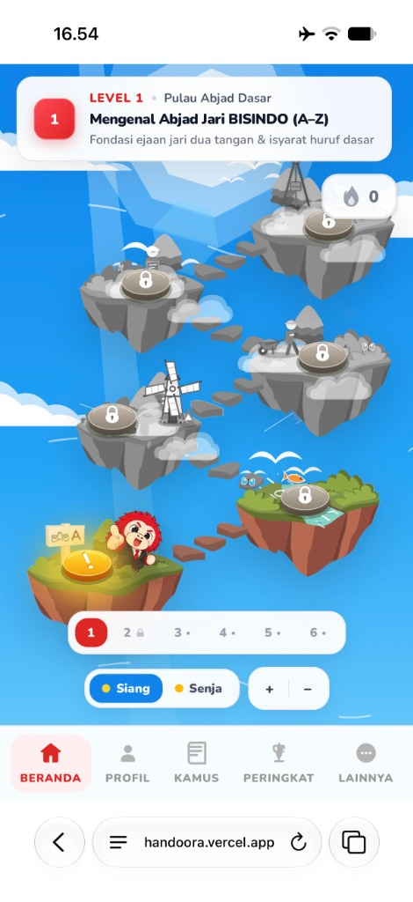
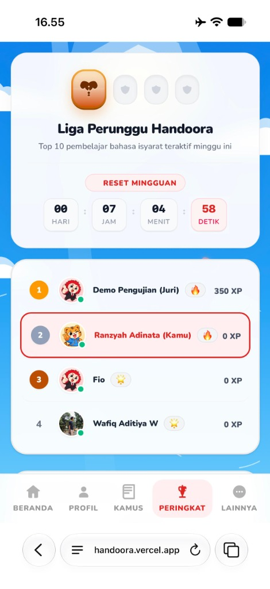
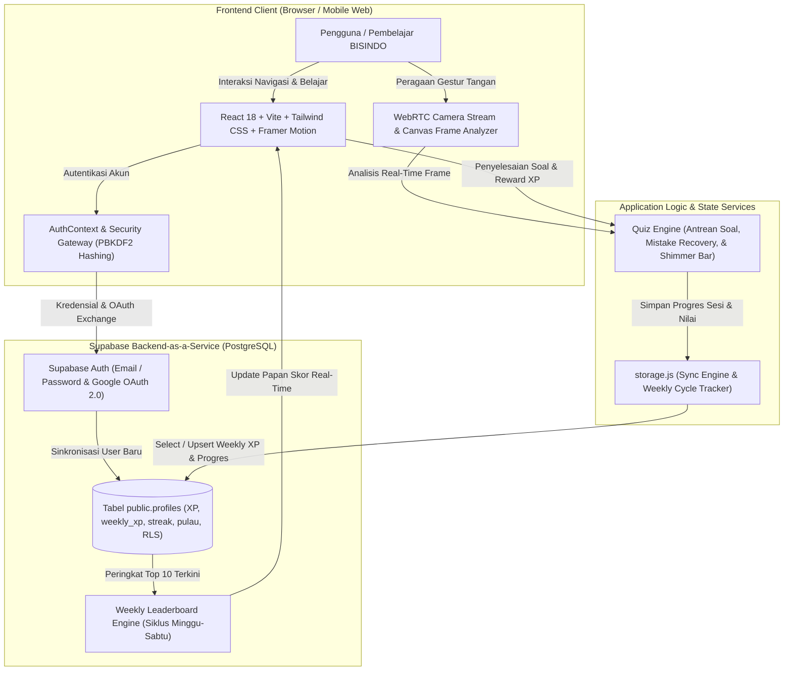

# 🤟 Handoora — Platform Edukasi Gamifikasi Bahasa Isyarat Indonesia (BISINDO)

<p align="center">
  
</p>

<p align="center">
  <b>"NextGen Digital Innovation: Crafting Creative Solutions for a Better Society"</b><br/>
  Karya Kompetisi <b>LOGICODIX Hackathon 2026</b><br/>
  Subtema: <b>Smart & Fun Education</b> & <b>Inclusive Health & Well-being</b>
</p>

<p align="center">
  <a href="https://handoora.vercel.app"></a>
  <a href="https://github.com/RanzyahAdinata/LOGICODIX-Handoora"></a>
  <a href="#-panduan-instalasi--menjalankan-aplikasi"></a>
  <a href="#-teknologi-yang-digunakan"></a>
</p>

<p align="center">
  🌐 <b>Live Web App:</b> <a href="https://handoora.vercel.app">https://handoora.vercel.app</a>
</p>

---

## 👥 1. Informasi Tim & Pengembang

| Atribut | Keterangan |
| :--- | :--- |
| **Nama Tim** | **4 Pilar Telyu** |
| **Kategori Kompetisi** | **Web App Development** |
| **Judul Karya** | **Handoora: Platform Edukasi Gamifikasi Bahasa Isyarat Indonesia** |
| **Institusi / Universitas** | **Telkom University** |
| **Fakultas / Departemen** | **Informatika** |
| **Ketua Tim** | **Ranzyah Adinata Aldo Ala Alfreda** (Hustler & Hacker) |
| **Informasi Kontak** | `ranzyah9@gmail.com` • [GitHub Profile (@RanzyahAdinata)](https://github.com/RanzyahAdinata) |
| **Subtema Utama** | **1. Smart & Fun Education**<br/>Solusi digital yang menjadikan proses belajar-mengajar interaktif, aksesibel, dan menyenangkan melalui gamifikasi serta AI asisten visualisasi isyarat.<br/>**2. Inclusive Health & Well-being**<br/>Membantu penyandang disabilitas Tuli dan masyarakat dengar dalam menjembatani komunikasi inklusif sehari-hari. |

### Susunan Anggota Tim:

| No. | Peran | Nama Lengkap | NIM |
| :---: | :--- | :--- | :---: |
| **1** | **Ketua Tim (Hustler & Hacker)** | **Ranzyah Adinata Aldo Ala Alfreda** | `103012430005` |
| **2** | **Anggota 1 (Hipster)** | **Salman Baihaqi** | `103012400008` |
| **3** | **Anggota 2 (Hacker)** | **Wafiq Aditiya Wiyono** | `103012400093` |
| **4** | **Anggota 3 (Hacker)** | **Anisah Pulungan** | `103012400344` |

---

## 💡 2. Deskripsi Produk, Masalah yang Diangkat, & Target Pengguna

### A. Masalah yang Diangkat
- **Tingginya Kesenjangan Komunikasi**: Di Indonesia terdapat lebih dari 2,5 juta teman Tuli yang mengandalkan **Bahasa Isyarat Indonesia (BISINDO)** sebagai bahasa ibu. Namun, mayoritas masyarakat dengar tidak memahami bahasa isyarat dasar.
- **Minimnya Media Pembelajaran Interaktif**: Metode konvensional buku saku atau video statis seringkali membosankan, tidak memiliki umpan balik langsung (*feedback loop*), serta minim motivasi belajar harian yang konsisten.
- **Ketiadaan AI Praktik Mandiri**: Pembelajar kesulitan memverifikasi apakah gerakan tangan yang mereka peragakan sudah benar tanpa kehadiran guru pembimbing.

### B. Solusi Inovatif: Handoora
**Handoora** adalah platform web aplikasi pembelajaran Bahasa Isyarat Indonesia (BISINDO) interaktif berbasis gamifikasi modern (*gamified learning adventure*) yang dipadukan dengan **Real-Time Computer Vision AI Gesture Recognition**:
1. **Kurikulum Terstruktur Berbasis Level & Tahap**: Mulai dari pengenalan abjad jari dua tangan (Level 1: A–Z), frasa percakapan sehari-hari, hingga komunikasi lanjutan.
2. **AI Real-Time Gesture Detection Loop**: Pengguna dapat mempraktikkan isyarat tangan langsung di depan kamera laptop/webcam dengan deteksi gestur real-time berakurasi tinggi secara instan di peramban tanpa perlu instalasi rumit.
3. **Ekosistem Gamifikasi Lengkap**: Peta kepulauan Nusantara interaktif, sistem *Daily Streak* (nyala api harian), *XP*, *Gems*, *Hearts/Nyawa*, *Papan Skor Liga Mingguan*, serta *Misi Harian*.
4. **Kamus Digital BISINDO Komprehensif**: Referensi visual gerakan isyarat tangan beresolusi tinggi (A–Z) yang tajam, bersih, dan mudah diakses kapan saja.

### C. Target Pengguna
1. **Pelajar & Mahasiswa**: Generasi muda yang ingin mengasah keterampilan bahasa isyarat inklusif secara mandiri, seru, dan menyenangkan.
2. **Keluarga & Sahabat Teman Tuli**: Mempererat kedekatan emosional melalui percakapan isyarat yang lancar.
3. **Tenaga Pendidik & Pelayan Publik**: Tenaga medis, staf pelayanan pemerintahan, dan customer service untuk menciptakan layanan publik yang ramah disabilitas.
4. **Komunitas Peduli Bahasa Isyarat**: Pegiat inklusi sosial di seluruh Indonesia.

---

## ✨ 3. Daftar Fitur Utama yang Berhasil Diimplementasikan

### 1. Sistem Autentikasi Modern & Keamanan Terenkripsi
- **Email & Password Authentication**: Menggunakan hashing kriptografi berlapis **PBKDF2-HMAC-SHA256 (100.000 iterasi)** pada sisi klien dan enkripsi **bcrypt** di Supabase Auth.
- **Google OAuth 2.0 Integration**: Masuk satu klik menggunakan akun Google resmi dengan sinkronisasi profil, avatar, dan nama pengguna otomatis.
- **Route Guarding**: Perlindungan rute terintegrasi (`ProtectedRoute` dan `PublicOnlyRoute`) untuk menjamin keamanan akses sesi pengguna.

### 2. Loading & Splash Screen Animatif Khas Handoora
- **Animated Mascot Group**: Menampilkan animasi melayang (*floating/bouncing*) maskot Doora dan teman-teman Handoora dengan partikel nada musik biru cerah dan bayangan dinamis.
- **Smart Loading Delay**: Memastikan splash screen tampil elegan minimal 1,8 detik saat memuat data, memberikan transisi visual yang menyenangkan.

### 3. Peta Petualangan Kepulauan Nusantara 3D Isometrik (`/belajar`)
- **Peta Bertema Kepulauan**: Desain bertahap (Pulau Abjad Dasar, Pulau Kata Dasar, Pulau Angka & Waktu, dsb.) dengan animasi floating island, awan bergulir, dan transisi pemandangan langit (Langit Cerah, Senja, Malam).
- **Session Resume Modal**: Menyimpan progres kuis yang sedang berjalan. Jika pengguna sempat beristirahat di tengah tahap, sistem otomatis menawarkan opsi melanjutkan dari titik soal terakhir atau mengulang dari awal.

### 4. Mesin Kuis Cerdas & AI Gesture Recognition (`/quiz` & `/training`)
- **Integrasi MediaPipe Hands Berkecepatan Tinggi**: Menggunakan MediaPipe Hands 21-landmark 3D tracking berpresisi tinggi untuk membaca koordinat sendi tangan pengguna secara instan di peramban tanpa latensi server.
- **3 Mode Soal Adaptif**:
  - *Peragakan Isyarat*: Membuka kamera depan dan mendeteksi gerakan tangan pengguna secara *real-time* dengan visual retikel dan timer akurasi tahan posisi (*hold progress*).
  - *Pilih Kartu Isyarat*: Memilih kartu visual gerakan tangan yang sesuai tanpa teks pembocor jawaban.
  - *Tebak Huruf*: Mengidentifikasi huruf dari kartu visual isyarat tangan.
- **Efek Audio Feedback Interaktif (Celesta & Glass Chimes)**: Audio interaktif bertema elegan (correct chime, wrong thud, skip, victory fanfare, & tap) yang dapat dinyalakan/dimatikan pada Pengaturan.
- **Mistake Recovery & Smart Skip**: Soal yang salah atau dilewati (*Lompati*) otomatis dipindahkan ke antrean paling belakang agar pengguna dapat menuntaskannya kembali sampai benar-benar paham.
- **Modern Animated Shimmer Progress Bar**: Indikator progres dengan transisi pegas (*spring physics*) dan efek kilau cahaya halus.
- **Celebration Result Page**: Statistik akurasi belajar, perolehan XP, nyala api streak, selebrasi konfeti partikel mewah, dan tombol *Lanjut* 3D tactile.

### 5. Liga Papan Skor Mingguan Real-Time & Sistem Streak Beruntun
- **Weekly League Leaderboard**: Siklus mingguan aktif (Minggu 00:00:00 hingga Sabtu 23:59:59) dengan hitung mundur waktu nyata (*real-time countdown*) dan badge Liga Perunggu *Wings of Victory*, hanya menampilkan pengguna yang terdaftar di aplikasi Handoora (mengecualikan akun admin).
- **Sinkronisasi XP, Avatar, & Streak Beruntun Akurat**: Perolehan XP, foto profil/avatar kustom maupun maskot, serta pelacakan api streak harian (`streak_history`) antara Profil, Dashboard, Admin, dan Leaderboard tersinkronisasi secara konsisten di Supabase `public.profiles`.

### 6. Kamus Digital BISINDO Lengkap (`/kamus`)
- **Katalog Isyarat Resolusi Tinggi Ultra-HD**: Aset visual gerakan isyarat tangan Level 1 (A–Z) dan kosakata Level 2 (Halo, Terima Kasih, Sama-sama, Minta Maaf, Selamat Pagi, Selamat Malam, Nama Saya, Sampai Jumpa Lagi) dengan posisi kanvas yang bersih dan simetris.
- **Filter Modul Smooth Scroll & Transisi AnimatePresence**: Filter kategori level yang dapat digulir dengan tombol navigasi halus kiri-kanan serta animasi pergantian kartu yang mulus tanpa kedip (*anti-flicker*).
- **Pencarian Cepat Cerdas**: Memfilter huruf, kosakata, dan deskripsi gerakan isyarat secara instan.

### 7. Panel Admin CRUD Data Pengguna (`/adminhandoora`)
- **Akses Terproteksi Khusus Admin**: Rute `/adminhandoora` dilengkapi gerbang autentikasi khusus administrator.
- **Manajemen CRUD Lengkap**: Admin dapat melihat ringkasan statistik pengguna (Total User, Total XP, Streak Aktif, Rata-rata Level), mencari dan memfilter sumber data pengguna, serta melakukan **Tambah**, **Edit** (nama, email, umur, password opsional, XP, streak, unit, dan progres level), dan **Hapus** data pengguna secara terpusat langsung ke `public.profiles` dan `auth.users` melalui fungsi RPC `SECURITY DEFINER`.

---

## 🖼️ Tampilan Antarmuka (UI) Handoora

| Halaman Utama (Landing Page) | Registrasi & Google OAuth |
| :---: | :---: |
|  |  |

| Peta Petualangan Kepulauan (`/belajar`) | Kamus Digital BISINDO (`/kamus`) |
| :---: | :---: |
|  |  |

### Tampilan Mobile Web (Responsif)

| Splash Screen | Halaman Utama | Peta Kepulauan (`/belajar`) | Liga Peringkat (`/leaderboard`) |
| :---: | :---: | :---: | :---: |
|  |  |  |  |

---

## 🛠️ 4. Teknologi yang Digunakan

### Frontend & Antarmuka
- **React 18.3**: Library JavaScript modern berbasis komponen reaktif.
- **Vite 6**: Alat build dan bundling kilat dengan modul Hot Module Replacement (HMR).
- **Tailwind CSS v4**: Framework CSS utility-first untuk tata letak modern dan responsif.
- **Framer Motion 11**: Pustaka animasi deklaratif untuk transisi halaman, efek pegas 3D, dan gerak interaktif.
- **React Icons & Custom SVG**: Ikonografi modern yang tajam dan ringan.
- **React Hot Toast**: Notifikasi pop-up feedback yang interaktif dan ramah pengguna.

### Frontend Documentation (Framework, Struktur Komponen UI, & Aset)
- **Framework & Library**: React 18.3, Vite 6 (HMR), Tailwind CSS v4, Framer Motion 11, React Router DOM, React Icons, dan React Hot Toast.
- **Struktur Komponen UI & Modul Aplikasi (`src/` & `public/`)**:
  ```text
  src/
  ├── App.jsx                  # Konfigurasi routing & route guarding (ProtectedRoute / PublicOnlyRoute)
  ├── context/AuthContext.jsx  # Manajemen sesi auth, Google OAuth callback, & auto-logout idle
  ├── pages/
  │   ├── LandingPage.jsx      # Halaman beranda & pengenalan platform
  │   ├── LoginPage.jsx        # Halaman masuk (Email/Password & Google OAuth)
  │   ├── RegisterPage.jsx     # Halaman pendaftaran akun baru
  │   ├── DashboardPage.jsx    # Peta kepulauan 3D, Profil, Kamus BISINDO, Leaderboard, & Pengaturan
  │   ├── QuizPage.jsx         # Kuis interaktif 3 mode soal + AI kamera real-time
  │   ├── TrainingPage.jsx     # Mode latihan bebas isyarat tangan dengan kamera
  │   └── AdminPage.jsx        # Panel CRUD manajemen data pengguna (/adminhandoora)
  ├── components/
  │   ├── auth/                # Komponen pengaman rute & autentikasi
  │   ├── common/              # Splash/loading screen animatif & elemen global
  │   ├── layout/              # Tata letak navigasi desktop & mobile bottom bar
  │   └── ui/                  # Tombol 3D tactile, modal, & kartu komponen
  ├── data/                    # Kurikulum soal Level 1–2 & data Kamus BISINDO (A–Z + frasa)
  ├── services/                # supabaseClient.js & storage.js (sync engine, streak, leaderboard, adminService)
  └── utils/                   # gestureDetector.js (127 fitur), mediapipeLoader.js, & soundEffects.js
  public/assets/               # Aset visual pulau, maskot, avatar, audio (.wav), & ilustrasi isyarat (signs/)
  ```

### Backend Documentation (API Endpoints, Database Schema, & `.env.example`)
- **Backend & Database**: Supabase (PostgreSQL + GoTrue Auth + PostgREST API) dengan hashing PBKDF2-HMAC-SHA256 (Web Crypto API) & bcrypt.
- **Database Schema (`supabase/schema.sql`)**:
  - **Tabel `public.profiles`**: `id` (`uuid`, FK ke `auth.users` `on delete cascade`), `nama`, `umur`, `email` (`unique not null`), `password_hash`, `auth_provider` (`email` / `google`), `avatar_url`, `xp`, `weekly_xp`, `weekly_cycle_id`, `streak`, `gems`, `hearts`, `current_unit`, `completed_lessons` (`jsonb`), `unlocked_islands` (`jsonb`), `last_activity_date`, `streak_history` (`jsonb`), `created_at`, `updated_at`.
  - **Trigger Otomatis**: `on_auth_user_created` memanggil `public.handle_new_user()` setiap kali user baru mendaftar via Email atau Google OAuth untuk langsung membuat baris profil di `public.profiles` mulai dari Level 1 (`0 XP`).
  - **Row Level Security (RLS)**: Kebijakan `SELECT` publik untuk Leaderboard, serta `INSERT`/`UPDATE` terbatas pada pemilik akun (`auth.uid() = id`).
- **Supabase Auth, REST, & RPC Endpoints**:
  - `POST /auth/v1/signup` & `POST /auth/v1/token?grant_type=password` — Registrasi dan login Email/Password.
  - `GET /auth/v1/authorize?provider=google` & `GET /auth/v1/settings` — Autentikasi Google OAuth 2.0 & pengecekan status provider.
  - `GET/POST/PATCH /rest/v1/profiles` — Membaca Leaderboard, mengambil profil user, serta menyimpan progres XP, streak, dan foto profil/avatar.
  - `POST /rest/v1/rpc/admin_upsert_profile`, `admin_update_profile`, & `admin_delete_user` — Fungsi RPC `SECURITY DEFINER` terverifikasi untuk operasi CRUD Panel Admin langsung ke `public.profiles` dan `auth.users`.
- **Variabel Lingkungan (`.env.example`)**: `VITE_SUPABASE_URL` dan `VITE_SUPABASE_ANON_KEY`.

### Infrastruktur & Deployment
- **Git & GitHub**: Version Control System dengan riwayat commit terstruktur sesuai konvensi standardisasi Git (*Conventional Commits*).
- **Vercel**: Platform hosting cloud untuk produksi dengan konfigurasi Single Page Application (SPA) rewrite.

---

## 🏗️ 5. Diagram Arsitektur Sistem & Alur Data



---

## 🚀 6. Panduan Instalasi, Konfigurasi, & Menjalankan Aplikasi

### A. Prasyarat Sistem
- **Node.js**: Versi `18.x` atau `20.x` LTS
- **npm**: Versi `9.x` atau lebih baru
- **Browser Modern**: Google Chrome, Microsoft Edge, Safari, atau Firefox yang mendukung akses kamera (WebRTC)
- **Koneksi Internet**: Untuk sinkronisasi database cloud Supabase

### B. Langkah Instalasi

1. **Clone Repositori Proyek**:
   ```bash
   git clone https://github.com/RanzyahAdinata/LOGICODIX-Handoora.git
   cd LOGICODIX-Handoora
   ```

2. **Instal Seluruh Dependensi**:
   ```bash
   npm install
   ```

3. **Konfigurasi Variabel Lingkungan (`.env`)**:
   Salin berkas `.env.example` menjadi `.env` pada direktori root proyek:
   ```bash
   cp .env.example .env
   ```
   Buka berkas `.env` lalu masukkan kredensial Supabase Anda:
   ```env
   VITE_SUPABASE_URL=https://your-project-id.supabase.co
   VITE_SUPABASE_ANON_KEY=your-supabase-anon-key
   ```

4. **Konfigurasi Database Supabase (SQL Script)**:
   - Masuk ke dashboard proyek Supabase Anda: [https://supabase.com/dashboard](https://supabase.com/dashboard)
   - Buka menu **SQL Editor**, buat query baru, lalu salin dan jalankan seluruh isi file [`supabase/schema.sql`](./supabase/schema.sql).
   - Skrip ini akan secara otomatis membuat tabel `public.profiles`, menambahkan kolom pelacakan `weekly_xp` dan `weekly_cycle_id`, mengonfigurasi indeks performa, mengaktifkan Row Level Security (RLS), serta menyiapkan *trigger* pembuatan profil pengguna baru.

5. **Menjalankan Server Pengembangan Lokal**:
   ```bash
   npm run dev
   ```
   Buka peramban di tautan `http://localhost:5173` (atau port yang ditampilkan di terminal).

6. **Build untuk Rilis Produksi**:
   ```bash
   npm run build
   npm run preview
   ```

### C. Panduan Deploy ke Vercel (Produksi Cloud 24/7)
1. **Konfigurasi SPA Routing**: Berkas [`vercel.json`](./vercel.json) sudah disiapkan agar seluruh rute React Router (`/belajar`, `/login`, `/register`, `/quiz/...`, `/training/...`, `/adminhandoora`) diarahkan ke `/index.html` tanpa error `404`.
2. **Environment Variables di Vercel**: Pastikan variabel berikut ditambahkan di *Project Settings → Environment Variables*:
   - `VITE_SUPABASE_URL`
   - `VITE_SUPABASE_ANON_KEY`
3. **Konfigurasi Supabase Auth**: Tambahkan domain Vercel Anda (misalnya `https://handoora.vercel.app/**`) ke **Authentication → URL Configuration → Redirect URLs** di Supabase Dashboard.

---

## 🧪 7. Akun Demonstrasi Pengujian

Untuk memudahkan evaluasi dewan juri tanpa perlu melakukan verifikasi email, tim Handoora telah menyediakan akun demonstrasi siap pakai:

| Peran | Email | Password | Akses Rute |
| :--- | :--- | :--- | :--- |
| **Akun Pengujian (Juri)** | `demo.handoora@gmail.com` | `HandooraPassword123!` | Akses penuh ke fitur belajar (`/belajar`), kuis kamera, Kamus BISINDO, Leaderboard, dan Profil |

*Catatan: Dewan juri juga dipersilakan mendaftarkan akun baru secara langsung di halaman `/register` atau menggunakan tombol Google OAuth.*

---

## 🤖 8. Dokumentasi Penggunaan AI & Pelatihan Mandiri Gesture Detection

### A. Pelatihan Mandiri Gesture Detection BISINDO (oleh Wafiq Aditiya Wiyono)
Sistem pengenalan gestur bahasa isyarat pada Handoora dikembangkan dari hasil pelatihan dan riset mandiri oleh anggota tim **Wafiq Aditiya Wiyono**:
- **Dataset Kaggle BISINDO**: [Indonesian Sign Language (BISINDO) Dataset — Wafiq Aditiya](https://www.kaggle.com/datasets/wafiqaditiya/indonesian-sign-language-bisindo-dataset)
- **Pipeline & File Pelatihan Mandiri ([`./dataset`](./dataset))**:
  - **Ekstraksi & Pengumpulan Dataset**: [`collect_alphabet.py`](./dataset/collect_alphabet.py), [`collect_words.py`](./dataset/collect_words.py), [`kata_label.csv`](./dataset/kata_label.csv), serta utilitas kurasi data ([`clean_dataset.py`](./dataset/clean_dataset.py), [`hapus_label.py`](./dataset/hapus_label.py), [`reset_kata.py`](./dataset/reset_kata.py), [`undo_dataset.py`](./dataset/undo_dataset.py)).
  - **Pelatihan Model**: [`train_model.py`](./dataset/train_model.py), [`train_level2.py`](./dataset/train_level2.py), dan [`train_words.py`](./dataset/train_words.py) menggunakan representasi **127 fitur koordinat MediaPipe Hands** (*Hand 1 [63] + Hand 2 [63] + Num Hands [1]*).
  - **Pengujian Real-Time**: [`test_realtime.py`](./dataset/test_realtime.py), [`test_words.py`](./dataset/test_words.py), dan [`app_level2.py`](./dataset/app_level2.py) untuk validasi akurasi gestur abjad (A–Z) dan kosakata Level 2 secara *real-time*.
- **Integrasi ke Aplikasi Web**: Logika ekstraksi 127 fitur dan aturan evaluasi gestur tersebut diadaptasi ke peramban pada [`src/utils/gestureDetector.js`](./src/utils/gestureDetector.js) dan [`src/utils/mediapipeLoader.js`](./src/utils/mediapipeLoader.js) agar berjalan instan tanpa latensi server.

### B. Penggunaan AI Sesuai Pedoman Kompetisi
Sesuai dengan ketentuan pedoman etika penggunaan AI pada **Guidebook LOGICODIX 2026**:
- **Alat & Model AI yang Digunakan**: **Google Antigravity (Gemini API & Antigravity Autonomous Agent)**.
- **Pemanfaatan dalam Proyek**:
  - Digunakan sebagai *AI Pair Programming Assistant* untuk mempercepat perancangan logika komponen React, penataan gaya visual responsif Tailwind CSS, serta perumusan skrip SQL Supabase Row Level Security (RLS).
  - Pemanfaatan *MediaPipe Hands 21-Landmark 3D Tracking* dan *Computer Vision Heuristic Analysis* untuk deteksi pose isyarat tangan interaktif berbasis kamera langsung di peramban pengguna.
- **Tanggung Jawab Kode**: Seluruh logika arsitektur, verifikasi fungsionalitas, keamanan data, dan pengujian sistem berada di bawah kendali dan tanggung jawab penuh tim pengembang Handoora.

---

## 📜 9. Atribusi Aset, Template, & Pustaka Pihak Ketiga

Seluruh aset dan pustaka eksternal yang digunakan dalam proyek ini mematuhi lisensi penggunaan terbuka:

1. **Aset Visual, Ilustrasi, & Karakter Maskot Handoora**:
   - Seluruh aset visual (logo, karakter maskot `mascot-group.png`, `avatar-tiger.png`, `avatar-orangutan.png`, `avatar-komodo.png`, peta kepulauan, serta elemen antarmuka) dibuat dan dirancang secara **manual dan kreatif** oleh anggota tim Handoora melalui Figma khusus untuk kompetisi LOGICODIX 2026: [Desain UI & Aset Handoora di Figma](https://www.figma.com/design/CT3iYQrbVVjoZfr9R4IBwq/HACKATON-UNESA-HANDOORA?node-id=50-2&p=f&t=qXOFSLq0xyWtdFsD-0).
2. **Foto & Ilustrasi Isyarat Jari BISINDO**:
   - Panduan visual gestur jari BISINDO (A–Z) dikurasi dan diselaraskan secara orisinal dari standar resmi Bahasa Isyarat Indonesia (BISINDO) untuk keperluan edukasi non-komersial.
3. **Tipografi**:
   - [Fredoka](https://fonts.google.com/specimen/Fredoka) & [Nunito](https://fonts.google.com/specimen/Nunito) via Google Fonts (Open Font License / OFL).
4. **Pustaka Open Source**:
   - React 18, Vite 6, Tailwind CSS, Framer Motion, React Router DOM, React Hot Toast, dan Supabase JS Client (Semua berlisensi MIT License).

---

<p align="center">
  Dibuat dengan ❤️ dan semangat inklusi oleh <b>Tim 4 Pilar Telyu — Telkom University</b><br/>
  <i>Mewujudkan Indonesia yang Ramah, Terbuka, dan Inklusif bagi Teman Tuli!</i>
</p>
