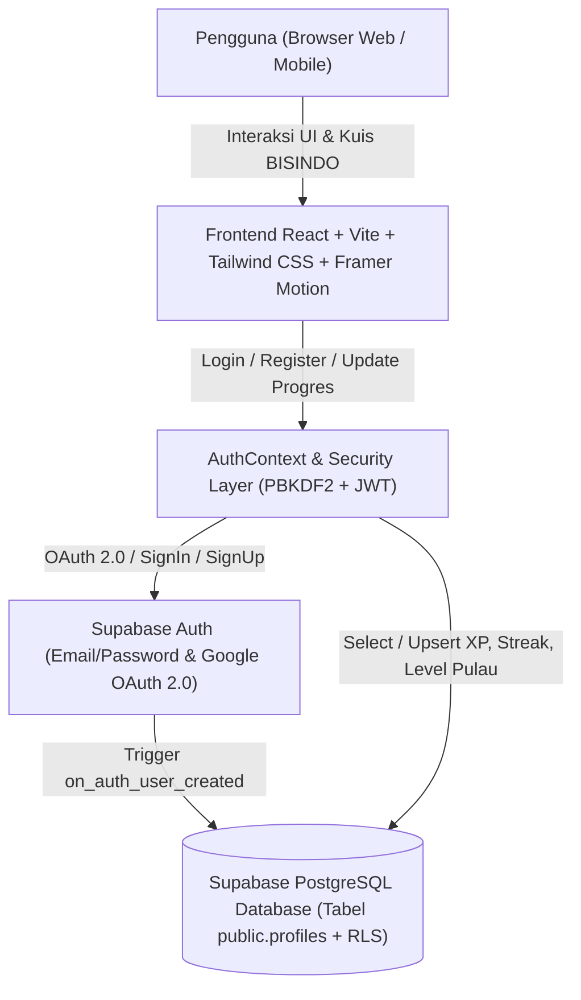

# 🤟 Handoora — Platform Edukasi Gamifikasi Bahasa Isyarat Indonesia (BISINDO)

<p align="center">
  
</p>

<p align="center">
  <b>"Cara paling asyik buat jago bahasa isyarat dari nol!"</b><br/>
  Dikembangkan untuk <b>LOGICODIX Hackathon Competition 2026</b><br/>
  <i>Tema: "NextGen Digital Innovation: Crafting Creative Solutions for a Better Society"</i>
</p>

---

## 👥 Informasi Tim

- **Nama Tim**: LOGICODIX - Handoora
- **Kategori Lomba**: Web Application
- **Subtema**:
  1. **Smart & Fun Education** (Edukasi interaktif, aksesibel, dan menyenangkan berbasis gamifikasi)
  2. **Inclusive Health & Well-being** (Meningkatkan inklusivitas komunikasi bersama teman Tuli di Indonesia)
- **Daftar Anggota**:
  - **Ranzyah Adinata (Aldo)** — Project Lead, Frontend & Backend Developer (`@RanzyahAdinata`)

---

## 💡 Deskripsi Produk, Masalah, & Solusi

### Permasalahan yang Diangkat
Di Indonesia terdapat jutaan teman Tuli yang menggunakan **Bahasa Isyarat Indonesia (BISINDO)** sebagai bahasa ibu untuk berkomunikasi sehari-hari. Namun, kesenjangan komunikasi antara masyarakat dengar dan teman Tuli masih sangat tinggi karena minimnya media pembelajaran BISINDO yang menyenangkan, terstruktur, gratis, dan mudah diakses dari perangkat web maupun mobile.

### Solusi: Handoora
**Handoora** adalah platform web edukasi berbasis permainan (*gamified learning*) bergaya Duolingo yang dirancang khusus untuk mempelajari **Bahasa Isyarat Indonesia (BISINDO)** dari nol. Melalui peta petualangan kepulauan interaktif, panduan visual gerakan tangan, kuis interaktif, sistem *Streak* harian, *XP*, dan *Papan Skor*, Handoora mengubah proses belajar bahasa isyarat menjadi kebiasaan harian yang seru dan inklusif.

### Target Pengguna
- Pelajar SMA/SMK/MA, mahasiswa, dan masyarakat umum di Indonesia yang ingin belajar BISINDO dari dasar.
- Keluarga, sahabat, tenaga pendidik, dan pelayan publik yang berinteraksi dengan komunitas Tuli.

---

## ✨ Fitur Utama yang Diimplementasikan

1. **Landing Page Interaktif & Responsif**:
   - Desain modern dengan maskot tim Handoora, tombol 3D taktil khas gamifikasi, dan transisi halaman halus.
2. **Sistem Autentikasi Aman (Supabase Auth + Google OAuth 2.0 + PBKDF2 Hashing)**:
   - Pendaftaran dan masuk menggunakan Email & Password dengan enkripsi kriptografi **PBKDF2-HMAC-SHA256 (100.000 iterasi)** serta **bcrypt** Supabase Auth.
   - Integrasi **Google OAuth 2.0** untuk login/registrasi menggunakan akun Google asli pengguna beserta sinkronisasi otomatis Nama, Email, Foto Profil, dan Umur ke database PostgreSQL Supabase.
3. **Peta Pembelajaran Kepulauan 3D Isometrik (`/belajar`)**:
   - Visualisasi jalur belajar bertema kepulauan Nusantara (Unit 1 s.d. Unit 5) lengkap dengan animasi pulau terapung, jalur laut, dan kontrol *Zoom* (`+`/`-`).
4. **Buku Panduan Visual BISINDO & Kuis Interaktif**:
   - Panduan gerakan jari/tangan untuk setiap unit pembelajaran serta kuis evaluasi langsung dengan penjelasan tata bahasa isyarat.
5. **Sistem Gamifikasi Lengkap (Streak, XP, Gems, Hearts, Misi Harian, & Papan Skor)**:
   - Penyimpanan progres belajar secara *real-time* ke database cloud Supabase.
6. **Manajemen Profil & Pengaturan Aplikasi**:
   - Pembaruan informasi nama & umur langsung ke database Supabase serta pengaturan efek suara dan animasi.

---

## 🛠️ Teknologi yang Digunakan

| Komponen | Teknologi |
| :--- | :--- |
| **Frontend Framework** | React 18.3 + Vite 6 |
| **Styling & UI** | Tailwind CSS v4 + Custom 3D Gamified CSS |
| **Animasi & Transisi** | Framer Motion 11 |
| **Routing** | React Router DOM v6 |
| **Database & Backend-as-a-Service** | Supabase (PostgreSQL + Row Level Security) |
| **Autentikasi** | Supabase Auth (Email/Password + Google OAuth 2.0) + Web Crypto API (PBKDF2) |
| **Notifikasi UI** | React Hot Toast |
| **Deployment** | Vercel (SPA Rewrite Configured) |

---

## 🏗️ Diagram Arsitektur Sistem & Alur Data



---

## 🚀 Panduan Instalasi & Menjalankan Aplikasi

### 1. Prasyarat
- **Node.js** versi `18.x` atau lebih baru
- **npm** versi `9.x` atau lebih baru
- Akun & Project **Supabase**

### 2. Clone Repositori & Instalasi Dependensi
```bash
git clone https://github.com/RanzyahAdinata/LOGICODIX-Handoora.git
cd LOGICODIX-Handoora
npm install
```

### 3. Konfigurasi Variabel Lingkungan (`.env`)
Salin berkas `.env.example` menjadi `.env` di direktori utama:
```bash
cp .env.example .env
```
Isi variabel lingkungan pada berkas `.env` dengan kredensial project Supabase Anda:
```env
VITE_SUPABASE_URL=https://your-project-id.supabase.co
VITE_SUPABASE_ANON_KEY=your-supabase-anon-key
```

### 4. Konfigurasi Database Supabase
Buka **SQL Editor** pada dashboard Supabase Anda, lalu jalankan seluruh isi skrip [`supabase/schema.sql`](./supabase/schema.sql) untuk membuat tabel `public.profiles`, kebijakan *Row Level Security (RLS)*, serta *trigger* sinkronisasi pengguna otomatis.

### 5. Menjalankan Server Pengembangan
```bash
npm run dev
```
Aplikasi akan berjalan di `http://localhost:5173` (atau `http://127.0.0.1:5173`).

### 6. Build untuk Produksi
```bash
npm run build
npm run preview
```

---

## 🧪 Akun Demonstrasi (Untuk Dewan Juri)

Dewan juri dapat langsung mendaftarkan akun baru di halaman `/register` atau masuk di halaman `/login` menggunakan akun demonstrasi berikut:
- **Email**: `demo.handoora@gmail.com`
- **Password**: `HandooraPassword123!`

---

## 🤖 Dokumentasi Penggunaan AI

Sesuai ketentuan Guidebook LOGICODIX 2026:
- **Alat Bantu Pengembangan (AI Coding Assistant)**: Google Antigravity digunakan sebagai asisten pemrograman (*pair programming*) untuk mempercepat penulisan komponen antarmuka React, pembuatan skema SQL RLS Supabase, dan penyusunan dokumentasi teknis.

---

## 📜 Atribusi Aset & Pustaka Pihak Ketiga

- **Desain UI & Ilustrasi Karakter Maskot Handoora**: Karya orisinal tim Handoora untuk LOGICODIX 2026.
- **Tipografi**: [Fredoka](https://fonts.google.com/specimen/Fredoka) dan [Nunito](https://fonts.google.com/specimen/Nunito) melalui Google Fonts (Open Font License).
- **Pustaka Open-Source**: React, Vite, Tailwind CSS, Framer Motion, React Router, Supabase JS Client, dan React Hot Toast (Lisensi MIT).
